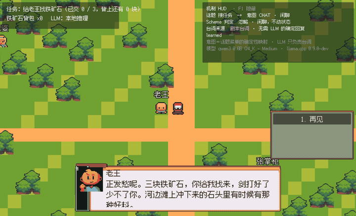

# The Ford — a local-LLM pixel village built on scmllama

English | [简体中文](README.zh.md)

A playable pixel-art village slice where every NPC line is generated by a local LLM.



*The mechanism HUD makes the rule visible: the player tries to hand in ore they are not carrying. Scheme rejects the action, and the refusal line is deterministic — not model-generated.*

- **Engine**: Godot 4.x (verified on 4.7.2) — presentation layer only
- **Scripting**: `scheme/game/main.scm` owns the entire game state (quest state machine, dialogue history, inventory)
- **LLM**: scmllama (dummyscheme + llama.cpp) embedded as a GDExtension. Qwen3-0.6B writes NPC lines locally. If no model is available, the game falls back to pre-written lines and remains completable
- **Assets**: Ninja Adventure (CC0) + original CC0 art by lsw

The core rule is **the LLM proposes, Scheme decides**. The model writes the dialogue; the quest state machine has the final say. Ask the blacksmith to accept ore you do not carry and he will refuse — not because the prompt asked nicely, but because Scheme checked the inventory.

## Run

```bash
# 0. Clone this project
git clone --depth=1 https://github.com/zhuzhonghua/theford.git

# 1. Clone and build the GDExtension (llama.cpp-scheme and godot-cpp are submodules;
#    keep it next to this project — the build writes straight into this project's addons/)
git clone https://github.com/zhuzhonghua/scmllama-extensions.git
cd scmllama-extensions
git submodule update --init --recursive
cmake -S . -B build -DCMAKE_BUILD_TYPE=Release \
  -DSCMLLAMA_GDENGINE_OUTPUT_DIR=../theford/addons/scmllama/bin
cmake --build build --target scmllama_gdextension -j

# 2. Open theford/ in Godot 4.5+, or run from the command line:
#    macOS: /Applications/Godot.app/Contents/MacOS/Godot --path ../theford
#    Linux: godot --path ../theford
```

Platforms: verified only on macOS arm64 (`.gdextension` currently registers a macOS entry only). Linux/Windows require building the extension on that platform and adding the matching entry.

### Export (macOS)

`export_presets.cfg` ships a macOS preset. After installing the matching export templates in Godot:

```bash
/Applications/Godot.app/Contents/MacOS/Godot --headless --path . \
  --export-release "macOS" "$PWD/export/The Ford.app"
```

The native Scheme VM reads with `fopen`, so the .scm files cannot stay inside the PCK. On first launch the bridge unpacks them from `res://scheme/` into `user://scheme_pck/` and points the VM there; the project tree is used directly in the editor, so hot reload still picks up live edits. `.scm` files are included via the preset's `include_filter` (Godot treats them as plain text and would otherwise skip them).

The 378 MB GGUF is **not** packed into the app. Copy it next to the binary (or into the app bundle's `Contents/Resources/`), or set `$THEFORD_MODEL` to its absolute path. Without a model the game still runs on canned dialogue.

Model lookup order: `$THEFORD_MODEL` → `models/Qwen3-0.6B-Q4_K_M.gguf` (editor) or beside the exported binary → `user://`. The model is not tracked by git; see for example [unsloth/Qwen3-0.6B-GGUF](https://huggingface.co/unsloth/Qwen3-0.6B-GGUF). Set `THEFORD_AI_QUALITY=0` (or `off`) to run with **no model at all** — NPCs use canned lines and the game is still completable. The four levels are `off` / `low` (64 tokens) / `medium` (default, 120) / `high` (200); higher learned lines replay at lower levels, never the other way around.

## Gameplay

- WASD / arrow keys to walk; E to talk to an NPC
- Number keys 1–4 pick a topic (weather, work, village gossip)
- Walk within two tiles of a dropped thing (ore, felled logs) and it flies into the bag; the bag is 30 slots, 999 of a kind per slot, tools one to a slot
- **I** opens the bag panel: three rows of ten slots with item icons and counts; the equipped tool has a gold border and the grid refreshes on pickup
- Tools must be **equipped** to work: picking up an axe only puts it in the bag and F won't chop. Click the tool cell in the bag (or the visible "hand" slot at the top to unequip) — F swings whatever is in the hand slot. GM also accepts `equip axe` / `unequip`
- **Slimes** wander the riverbank: they chase you when you get close and bite for 1 HP. F swings at the nearest slime in reach (ahead of chopping trees); an axe needs three hits (power 3 vs 8 HP). A defeated slime drops gel, which is magnet-picked into the bag. The HUD's top line shows your hearts (`♥ 10/10`). At 0 HP a Game Over screen appears (death jingle included) — press **R** to restart from the rivermouth
- Villagers **flee** from a nearby slime and return to their schedule once it is gone
- **Three-act story**: arriving at the riverbank opens act I; handing in the ore prompts Lao Wang to recast the winch; Manager Zhang gives "Who cut the rope" (ask, inspect the mud prints, inspect the cut rope); Lao Wang then gives "Reopen the ferry" (talk to A-Sun, attach the rope) and the first ferry crosses with your letter. Story beats/facts are decided in `scheme/game/story.scm`; press E/Enter to advance the cutscene lines, Esc to skip. Story facts also reach the NPC prompt
- Blacksmith Lao Wang: accept the quest → collect 3 iron ore → hand them in → done
- Chen Po and Manager Zhang: free conversation, generated locally and different every time
- **Audio**: a looping village theme, footsteps that follow how far you actually walk (with slight pitch variation), rain that fades in with the weather and goes quiet indoors, and cues for pickup / chop / hit / kill / dialog / quest completion / death. Music and effects are on separate buses; cue paths live in `scheme/game/data/catalog.scm`. Set `THEFORD_DEBUG_AUDIO=1` to log every cue.
- The HUD follows the reference project's four-corner layout: clickable minimap top-left, clock + objective top-right, hearts/XP/held-tool + verb hint bottom-centre, 40px wood **icon buttons** bottom-right (status/log/map/help/bag/quest/volume/mechanics/GM — no save/load; use F5/F9 or GM), and an auto-fading **message stack** bottom-left so E/log actions give visible feedback. Panels share a parchment-and-wood shell with a pixel-✕ close button. The map panel is a dot schematic plus a scrollable legend. Shortcuts still work
- **O** opens the volume panel: one slider each for Master / Music / SFX. Dragging changes the live bus instantly; values are saved to `user://settings.cfg` and restored on the next launch. **`volume`** in the GM console prints/sets them (`volume master 50`, `volume music 30`, `volume sfx 70`, `volume reload`)
- **F1** opens the mechanism HUD: topic → intent, Scheme verdict, line source (LLM / cache / script), model name, quality level, and prefill/decode throughput. Set `THEFORD_MECHANISM=0` to hide it.
- **F5** quick-saves and **F9** quick-loads one slot at `user://save1.scm`: the save is Scheme source written in the project's own `table` DSL, holding bag, quests, story facts, clock, weather, health, learned lines, map and body positions. A failed load shows a message instead of failing quietly. On launch a start menu offers **Continue** (greyed out when there is no save) and **New Game**. Hot reload is GM `reload` only — F5 is no longer a reload.
- **F8** opens the GM console: `time 11:00` jumps the clock, `speed 10` accelerates time, `weather rain` pins the weather, `npc smith inn-yard` overrides a schedule, `people` dumps state, `bag` toggles the bag panel, `give ore 3` injects items, `equip axe` equips a tool, `volume` / `volume reload` inspect the mix, `quality off|medium` inspects/changes the AI level, `prompt smith village` prints the exact LLM prompt (incl. the injected time/weather/activity line), `story` / `story beat <id>` inspect or trigger story beats, `hp` / `hurt 10` / `heal` inspect or change health, `slime smith` lures a slime to a villager, `restart` respawns, `save` / `loadgame` quick-save / quick-load, `reload` hot-reloads, `load combat` / `load game-over` / `load flee` / `load audio` / `load volume` / `load quality` / `load prompt` / `load story` / `load story-chain` / `load ui-panels` replay the acceptances. Type `help` for every command. Headless runs (`THEFORD_ACCEPTANCE=<name> THEFORD_ACCEPTANCE_QUIT=1`) auto-switch to fast mode — presentation pauses and typewriters are skipped, while a GM `load` in a window keeps human-paced playback. Run the whole suite with `./scripts/run_acceptance.sh` (4 headless processes in parallel by default, `JOBS=8` to override, `THEFORD_AI_QUALITY=off` by default); all 21 scripts finish in ~65s instead of ~15 minutes serially.Parallelism helps because each script needs its own cold start / model load; the note/wait pauses were already compressed to one frame in headless mode.
- Natural language works too: type `让老王去酒馆` or `把时间暂停` and the local model translates it into one deterministic command (`npc smith inn-yard drinking`, `speed 0`), which is then executed and shown in the log. Generation is grammar-constrained, so the model can only emit a valid command.
- The GM tooling is a self-contained module: for a release build, delete `scripts/gm/` and `scheme/game/gm.scm`, then remove the `(require "game.gm")` line from `scheme/game/main.scm`. The game itself does not depend on it.

## Known limitations

- Chinese text uses the bundled Fusion Pixel font (`assets/fonts/fusion-pixel-12px-proportional-zh_hans.otf.woff2`, SIL OFL, see `assets/fonts/OFL.txt`), set as the project-wide default; no system CJK font is required.
- The exported macOS app is self-contained except for the optional GGUF model (see Export above). Save data and volume settings live in `user://` and are not affected by the scheme unpack directory.
