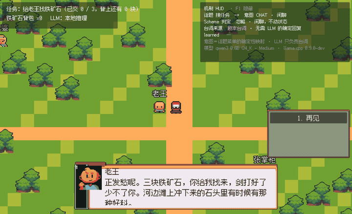

# 《渡口》The Ford — scmllama LLM 村庄 demo

[English](README.md) | 简体中文

一个本地 LLM 驱动 NPC 的像素村庄切片：



*HUD 把规则显影：玩家想交矿石，但背上是 0 块。Scheme 拒绝这次动作，拒绝台词由剧本确定，不经过模型。*

- **引擎**：Godot 4.x（本机 4.7.2），只做表现层
- **脚本**：`scheme/game/main.scm` 拥有全部游戏状态（任务状态机/对话历史/背包）
- **LLM**：scmllama（dummyscheme + llama.cpp）以 GDExtension 形式内嵌，
  本地 Qwen3-0.6B 生成 NPC 台词；无模型时自动回退预置台词，游戏照样可通关
- **素材**：Ninja Adventure（CC0）+ lsw 自绘 CC0 素材

## 运行

```bash
# 0. 克隆本项目
git clone --depth=1 https://github.com/zhuzhonghua/theford.git

# 1. 克隆并构建 GDExtension（含 llama.cpp-scheme 与 godot-cpp 两个 submodule，
#    与本项目并排放；输出直接写进本项目的 addons 目录）
git clone https://github.com/zhuzhonghua/scmllama-extensions.git
cd scmllama-extensions
git submodule update --init --recursive
cmake -S . -B build -DCMAKE_BUILD_TYPE=Release \
  -DSCMLLAMA_GDENGINE_OUTPUT_DIR=../theford/addons/scmllama/bin
cmake --build build --target scmllama_gdextension -j

# 2. 用 Godot 4.5+ 打开 theford 目录，或命令行运行：
#    macOS: /Applications/Godot.app/Contents/MacOS/Godot --path ../theford
#    Linux: godot --path ../theford
```

平台：目前仅在 macOS arm64 上验证（`.gdextension` 只注册了 macos 条目）；
Linux/Windows 需在对应平台构建扩展，并在该文件里补对应条目。

模型查找顺序：`$THEFORD_MODEL` → `models/Qwen3-0.6B-Q4_K_M.gguf`（项目自带，不入 git）。


## 玩法

- WASD/方向键走路，E 与 NPC 对话
- 数字键 1-4 选话题；天气、活计、村子的事按话题问
- 走到掉落物（矿石、砍下的原木）两格内自动吸进背包；背包 30 格、每格同种最多 999，工具一件一槽
- 铁匠老王：接任务 → 捡 3 块铁矿石 → 交任务 → 完结
- 陈婆/张掌柜：纯对话（本地 LLM 生成，逐次不同）
- **F1** 打开"机制 HUD"：话题 → 意图、Scheme 判定、台词来源（LLM / 缓存 / 剧本）、
  模型名与 prefill/decode 速度；`THEFORD_MECHANISM=0` 可关闭
- **F8** 打开 GM 控制台：`time 11:00` 跳时钟、`speed 10` 加速时间、
  `weather rain` 强制天气、`npc smith inn-yard` 覆盖日程、`people` 查看状态；输入 `help` 看全部指令
- 也可以直接输入中文：`让老王去酒馆`、`把时间暂停`，本地模型会翻译成一条确定性指令
  （`npc smith inn-yard drinking`、`speed 0`）再执行，日志里会显示 `LLM → …`。
  生成受 grammar 约束，模型只能输出合法指令
- GM 是独立模块，发布时整体删除 `scripts/gm/` 与 `scheme/game/gm.scm`，再去掉
  `scheme/game/main.scm` 末尾的 `(require "game.gm")` 即可；主游戏不依赖它

## 已知边界

- 中文用项目自带字体渲染：`assets/fonts/fusion-pixel-12px-proportional-zh_hans.otf.woff2`
  （Fusion Pixel，SIL OFL 许可，见 `assets/fonts/OFL.txt`），不依赖系统字体
- `res://` scheme 路径只在编辑器/调试模式下指向项目目录；
  导出可执行文件需把 scheme 文件打进 PCK 并改造读取路径
